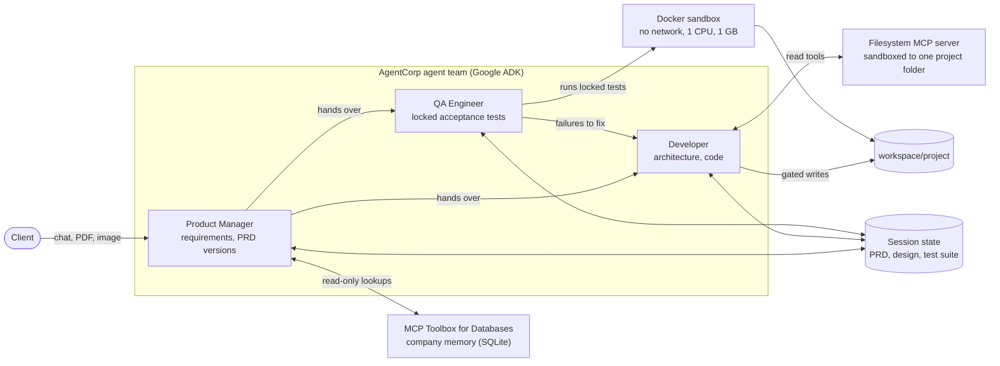
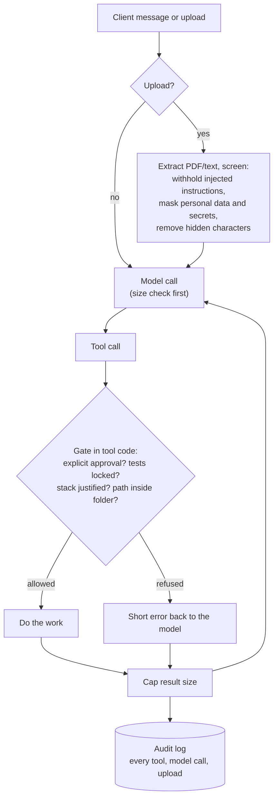

# AgentCorp architecture

Three views: what exists today, how one request travels through the controls, and how it maps to
Google Cloud. **Sections 1 and 2 are built and tested. Sections 3 and 4 are a design, not yet built.**

## 1. The agents (built)

The conversation holds the chat; **session state holds the work product** (PRD, architecture, tests,
results). Nothing important lives only in a prompt.

## 2. One request, and the controls it passes (built)

| Layer | What it stops | Where |
|---|---|---|
| Upload screening | A brief that tells the AI to approve things; personal data reaching the model | `shared/uploads.py`, `shared/guardrails.py` |
| Gates in tool code | The model approving, publishing or building without the client's explicit words or locked tests | `pm_agent/`, `dev_agent/`, `qa_agent/` |
| Sandboxes | Generated code reaching the network or other folders | filesystem MCP boundary, Docker runner |
| Result and context caps | One oversized result or history making a session unusable | `shared/safety.py` |
| Audit log | "What did it actually do?" being answered from memory | `shared/audit.py`, `scripts/audit_report.py` |
| Evals and incident tests | The same failure coming back | `evals/`, `docs/incidents.md`, `tests/` |

The principle: **the model decides content, code decides structure.** A prompt can be talked around;
a check in code cannot.

## 3. Mapping to Google Cloud (design, not built)

| Today (local) | On Google Cloud | Why it is a straight swap |
|---|---|---|
| Nemotron via LiteLLM | Gemini on Vertex AI | One config line (`shared/models.py` already routes by model name) |
| Local SQLite sessions | Agent Engine managed sessions | ADK session service interface |
| `adk web` | Agent deployed to Vertex AI Agent Engine, registered in Gemini Enterprise | Same ADK agents |
| MCP Toolbox on a laptop | Toolbox on Cloud Run, backed by Cloud SQL or AlloyDB | Same `tools.yaml` format |
| Audit JSONL file | Cloud Logging and Cloud Trace (OpenTelemetry) | ADK already emits traces |
| `shared/guardrails.py` | Model Armor, with the local screen kept as a second layer | Same screen-then-mask idea |
| Docker test runner | Agent Engine code execution or a Cloud Run job | Same "run locked tests, grade by XML" contract |
| `.env` keys | Secret Manager, one service account per agent with least privilege | Removes keys from files |
| Eval suite | Run on Gemini; compare with Nemotron | Same cases, two models |

## 4. In a customer's cloud: networking and tenancy (design, not built)

- **One project per customer** (or per environment) as the tenancy boundary; no shared state
  between tenants. Sessions are already keyed by user and app.
- **Private by default:** Toolbox and any database reachable only over private networking
  (Private Service Connect); a VPC Service Controls perimeter around Vertex AI, storage and logs so
  data cannot be copied out to a project outside the perimeter.
- **Identity:** each agent runs as its own service account with only the roles it needs (the
  Developer agent never gets database access; the PM never gets deploy rights). End-user access
  through Workspace OAuth scopes limited to the files they choose.
- **Keys and residency:** customer-managed encryption keys (CMEK) if required; region pinned to
  the customer's data-residency rule.
- **Evidence:** audit log to a locked log bucket, retained per the customer's policy.
